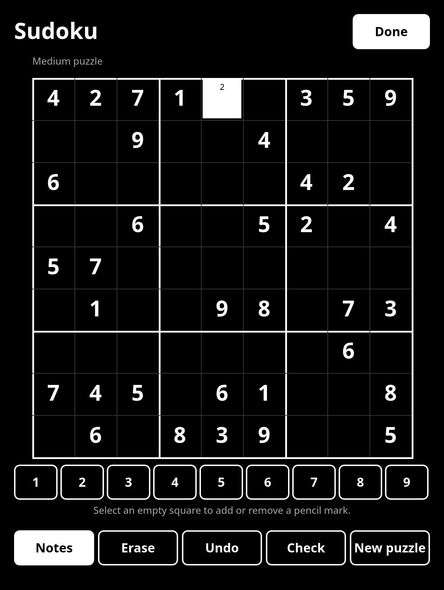
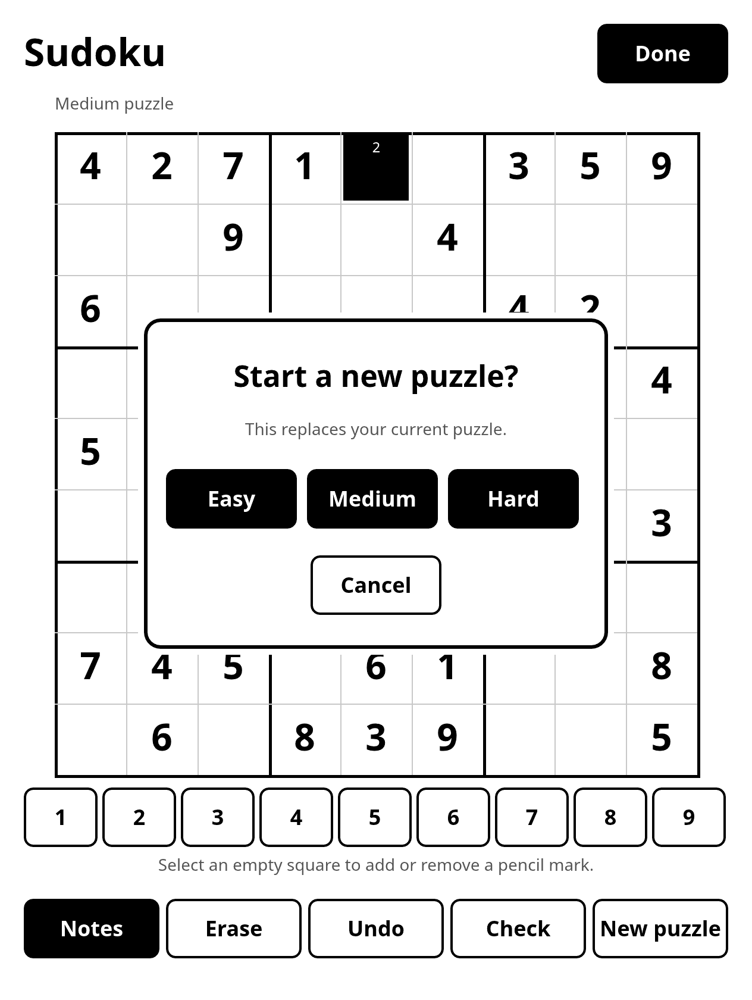

<div align="center">

# Sudoku

**Sudoku for jailbroken Kindle e-readers.**

[**Install guide**](INSTALL.md) ·
[**Device notes**](docs/device-notes.md) ·
[**Changelog**](CHANGELOG.md)

</div>

---

Play fresh 9 × 9 puzzles with large number keys and pencil marks. Every generated puzzle has exactly one solution.

## Screenshots

<table>
  <tr>
    <td align="center"><br><sub>A medium puzzle</sub></td>
    <td align="center"><br><sub>Pencil marks in dark mode</sub></td>
    <td align="center"><br><sub>Choose a difficulty</sub></td>
  </tr>
</table>

<sub>Screenshots from the desktop simulator at 1264 × 1680, using sample puzzles.</sub>

## Highlights

- **Three difficulties.** Generate an Easy, Medium, or Hard puzzle.
- **Pencil marks.** Use Notes to add or remove candidates in an empty square.
- **Check and undo.** Mark incorrect entries with Check, or restore the previous contents of a square with Undo.
- **Saved progress.** Reopen your puzzle with its entries, notes, and undo history.

## Quick start

For a local USB test, extract the ARMHF test package and copy the `sudoku` and `documents` folders to the Kindle's
user storage. Eject the Kindle and open Sudoku from the Primitive Launcher grid. The app uses the
launcher's fonts, drawing, input, rotation, and sleep handling. [Install guide](INSTALL.md)

## Status

Desktop tests and previews passed on macOS, and the ARMHF package passed the local Store fixture.
On an ARMHF Kindle Oasis 3 running firmware 5.18.2, Sudoku opened from Launcher, showed the new-puzzle
confirmation, returned to the same puzzle after Cancel, and returned to Launcher. `app.json` contains the draft
Store listing. [Device notes](docs/device-notes.md)

## Develop locally

Keep the Primitive Tools and Launcher repositories beside this checkout. The desktop command runs sample taps
and writes PNG previews to `build/previews`.

```sh
cargo test --offline --locked --workspace
cargo run --offline --locked -p sudoku-desktop
```

## Licence

Copyright (C) 2026 Doan Nguyen.

- Original code is under the [PolyForm Noncommercial License 1.0.0](LICENSE).
- Original documentation and pictures, including these screenshots, are under [CC BY-NC-SA 4.0](LICENSE-DOCS).
- The Noto Sans fonts supplied by Primitive Launcher retain their SIL Open Font License.
